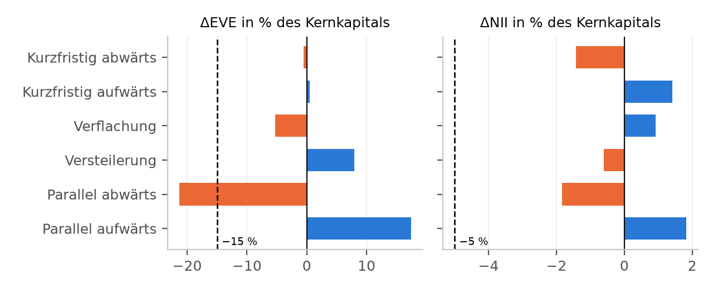

*Generated by `task report` from `results/`; do not edit by hand.*

# Module 3: ALM, liquidity and IRRBB

| Measure | Value |
|---|---|
| LCR | 239.3% |
| HQLA / net outflows | 1,688.3m EUR / 705.5m EUR |
| NSFR | 119.1% |
| ASF / RSF | 7,258.0m EUR / 6,095.9m EUR |
| Deposit core share (balance-weighted) | 72.6% |
| Max |Kaplan–Meier − model| | 1.03% |
| 1-year cumulative gap, contractual | −3,368.1m EUR |
| 1-year cumulative gap, behavioural | 294.5m EUR |
| Average FTP rate | 3.29% |
| Curve date | 2026-11-19 |

## Six supervisory shocks

| Scenario | ΔEVE (m EUR) | ΔEVE / Tier 1 | ΔNII (m EUR) | ΔNII / Tier 1 |
|---|---|---|---|---|
| parallel_up | 124.5 | 17.4% | 13.1 | 1.8% |
| parallel_down | −152.5 | −21.3% | −13.1 | −1.8% |
| steepener | 56.9 | 8.0% | −4.4 | −0.6% |
| flattener | −37.8 | −5.3% | 6.6 | 0.9% |
| short_up | 3.5 | 0.5% | 10.1 | 1.4% |
| short_down | −3.8 | −0.5% | −10.1 | −1.4% |

EVE outlier threshold 15% of Tier 1 (CRD Art. 98(5)): outlier = yes. NII large-decline threshold 5% (RTS 2024/856 Art. 5): flag = no.

