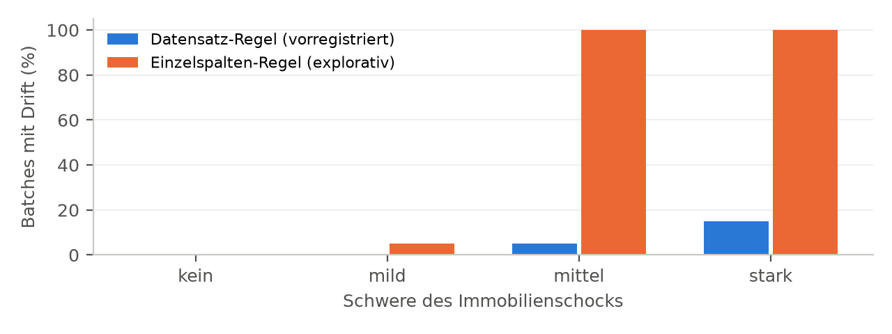

*Generated by `task report` from `results/`; do not edit by hand.*

# Module 7: MLOps

## Experiment tracking

Every `task pipeline` run logs 7 MLflow runs (experiment `kapitalkompass`, local sqlite store in `mlruns/`), each with its config as params, every numeric result as a metric and the tags `module`, `git_commit`, `git_dirty`, `data_hash`, `results_sha256`.

| Module | Params | Metrics | Results hash |
|---|---|---|---|
| alm | 89 | 73 | `1ac5f0f108fc` |
| bayes | 21 | 53 | `49de7adeeb27` |
| credit | 21 | 34 | `0c6208adbf67` |
| data | 89 | 0 | `e3b0c44298fc` |
| drift | 30 | 48 | `dc2b520c4982` |
| experiments | 30 | 12 | `9dd3db3813f5` |
| steering | 35 | 21 | `0f756a6d6c19` |

Reproducibility (last two MLflow runs per module with the same data hash; depends on run history, so outside the bit-for-bit claim):

| Module | Metrics compared | Identical | Max rel. diff | Results hash equal |
|---|---|---|---|---|
| alm | 73 | 73 | 0.0e+00 | yes |
| bayes | 53 | 53 | 0.0e+00 | yes |
| credit | 34 | 34 | 0.0e+00 | yes |
| data | 0 | 0 | 0.0e+00 | yes |
| drift | 48 | 48 | 0.0e+00 | yes |
| experiments | 12 | 12 | 0.0e+00 | yes |
| steering | 21 | 21 | 0.0e+00 | no |

## Drift monitor (Evidently)

20 batches of 2,000 loans per shock severity against a 5,000-loan reference sample. Evidently DataDriftPreset: Wasserstein (normed) for numeric, Jensen-Shannon for categorical and low-cardinality columns, threshold 0.1; dataset drift if the share of drifted columns >= drift_share.

| Severity | Dataset rule (pre-registered) | Any-column rule (exploratory) |
|---|---|---|
| none (0.00) | 0% | 0% |
| mild (0.33) | 0% | 5% |
| medium (0.67) | 5% | 100% |
| strong (1.00) | 15% | 100% |

Per-column drift rate at the strong shock: client_margin 100%, ead_eur 0%, grade 0%, lgd 100%, maturity_years 15%, pd 0%, sector 0%.

The real-estate shock moves LGD and margins, but the sector mix (+10 points) and the one-notch downgrades stay under Evidently's 0.1 distance threshold on a mixed batch, so the dataset rule (≥ 30% of 7 columns) rarely fires. A sector-segmented or column-level monitor is needed for sector shocks.

HTML report for one strong-shock batch: `reports/drift_report_strong_shock.html` (generated, not committed).
