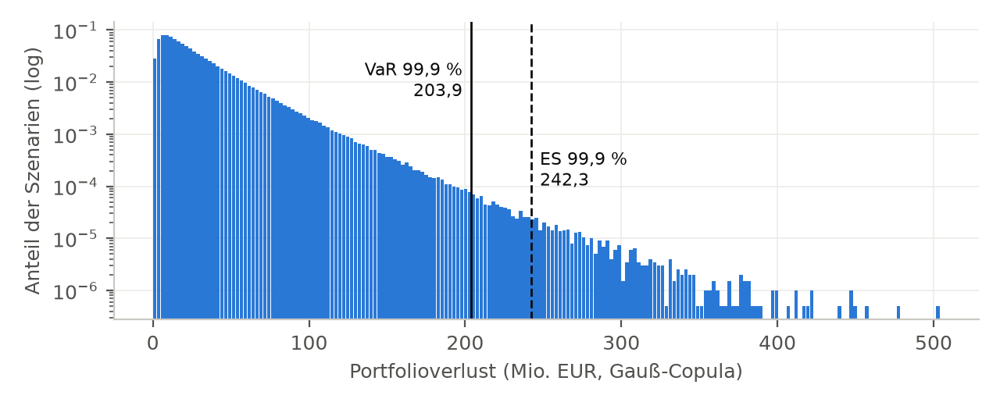

*Generated by `task report` from `results/`; do not edit by hand.*

# Module 1: credit portfolio model

| Measure | Value |
|---|---|
| Obligors / segments | 50,000 / 12 |
| Total EAD | 5,806.4m EUR |
| Scenarios (Gaussian copula) | 2,000,000 |
| Expected loss (analytic / simulated) | 27.6m EUR / 27.6m EUR |
| VaR 99.9% / ES 99.9% | 203.9m EUR / 242.3m EUR |
| Economic capital (ES − EL) | 214.7m EUR |
| ASRF UL (analytic) | 228.7m EUR |
| One-factor UL / ASRF UL | 1.022 |
| Multi-factor UL / ASRF UL | 0.771 |
| t copula (ν = 6) ES / Gaussian ES | 3.04 |
| Name HHI / effective number of names | 0.00113 / 882 |
| Top-10 share of EAD | 8.3% |
| IRB capital requirement (reference) | 353.9m EUR |

## Economic capital by segment (Euler ES contributions − EL)

| Segment | EAD (m EUR) | EL (m EUR) | EC (m EUR) | EC share |
|---|---|---|---|---|
| manufacturing_3 | 711.1 | 4.50 | 47.34 | 22.0% |
| manufacturing_4 | 327.2 | 6.24 | 36.39 | 16.9% |
| manufacturing_2 | 903.9 | 1.84 | 32.27 | 15.0% |
| trade_3 | 511.8 | 3.46 | 21.21 | 9.9% |
| trade_4 | 213.4 | 4.73 | 18.13 | 8.4% |
| trade_2 | 650.5 | 1.48 | 12.83 | 6.0% |
| real_estate_3 | 383.8 | 1.49 | 11.63 | 5.4% |
| manufacturing_1 | 625.2 | 0.39 | 11.44 | 5.3% |
| real_estate_4 | 220.5 | 2.41 | 11.39 | 5.3% |
| real_estate_2 | 514.6 | 0.62 | 6.80 | 3.2% |
| trade_1 | 426.2 | 0.29 | 3.49 | 1.6% |
| real_estate_1 | 318.1 | 0.12 | 1.79 | 0.8% |

## Benchmark (one run per engine; hardware-dependent, not part of the reproducibility claim)

| Engine | s per 1M scenarios | J per 1M scenarios | Speed-up vs numpy |
|---|---|---|---|
| numpy_1core | 982.1 | 49,068 | 1.0 |
| numba_parallel | 142.0 | 14,259 | 6.9 |
| torch_cpu | 270.3 | 12,573 | 3.6 |
| torch_cuda | 5.6 | 664 | 176.9 |
