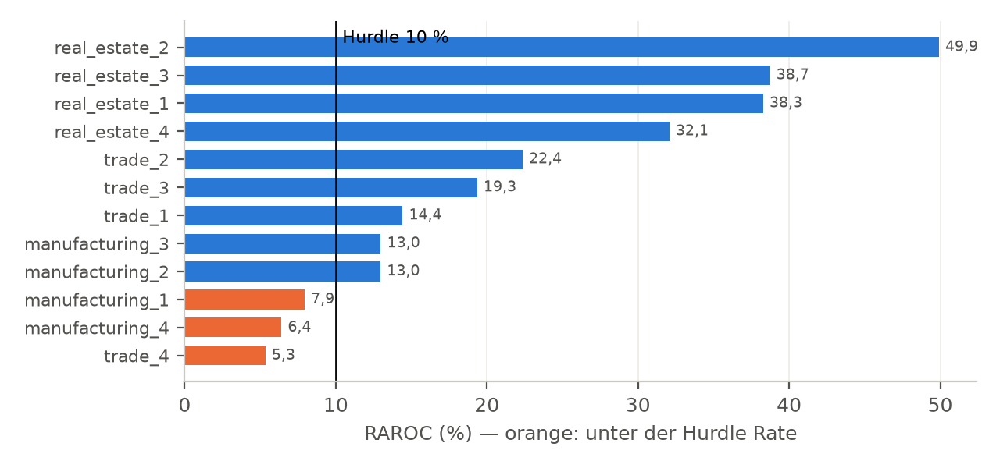

*Generated by `task report` from `results/`; do not edit by hand.*

# Module 4: RAROC and capital allocation

Bank RAROC 15.9% against a hurdle of 10%; 3 of 12 segments below hurdle (manufacturing_1, manufacturing_4, trade_4). Euler allocation relative gap 1.2e-10.

| Segment | EAD (m EUR) | NIM after FTP | Fees | Opex | EL | EC | RAROC | EVA |
|---|---|---|---|---|---|---|---|---|
| real_estate_2 | 514.6 | 5.02 | 1.05 | 2.06 | 0.62 | 6.80 | 49.9% | 2.71 |
| real_estate_3 | 383.8 | 6.79 | 0.74 | 1.54 | 1.49 | 11.63 | 38.7% | 3.34 |
| real_estate_1 | 318.1 | 1.46 | 0.61 | 1.27 | 0.12 | 1.79 | 38.3% | 0.50 |
| real_estate_4 | 220.5 | 6.48 | 0.46 | 0.88 | 2.41 | 11.39 | 32.1% | 2.51 |
| trade_2 | 650.5 | 7.65 | 1.25 | 4.55 | 1.48 | 12.83 | 22.4% | 1.59 |
| trade_3 | 511.8 | 10.07 | 1.08 | 3.58 | 3.46 | 21.21 | 19.3% | 1.98 |
| trade_1 | 426.2 | 2.93 | 0.84 | 2.98 | 0.29 | 3.49 | 14.4% | 0.15 |
| manufacturing_3 | 711.1 | 13.43 | 1.48 | 4.27 | 4.50 | 47.34 | 13.0% | 1.41 |
| manufacturing_2 | 903.9 | 9.74 | 1.70 | 5.42 | 1.84 | 32.27 | 13.0% | 0.95 |
| manufacturing_1 | 625.2 | 4.00 | 1.05 | 3.75 | 0.39 | 11.44 | 7.9% | −0.24 |
| manufacturing_4 | 327.2 | 9.99 | 0.55 | 1.96 | 6.24 | 36.39 | 6.4% | −1.31 |
| trade_4 | 213.4 | 6.77 | 0.42 | 1.49 | 4.73 | 18.13 | 5.3% | −0.85 |

Amounts in m EUR. RAROC = (NIM after FTP + fees − opex − EL) / economic capital.

